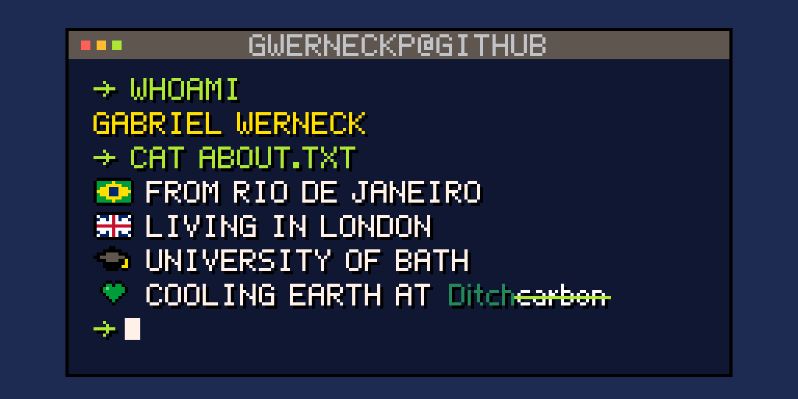

<h2 align="left">Hi! I'm Gabriel Werneck.</h2>

###

###

Junior Software Engineer at [DitchCarbon](https://ditchcarbon.com) 🌱 Based in London, studying at the University of Bath.
I like reverse-engineering protocols, building clean Python libraries, and automating the boring parts of everyday life.

### ✨ Selected projects

<table>
  <tr>
    <td width="50%" valign="top">
      <h4>⌚ <a href="https://github.com/gwerneckp/garmin-ble">garmin-ble</a></h4>
      A Python client for Garmin's proprietary BLE protocol, reverse-engineered from scratch. Talks to the watch directly, with no cloud, no phone and no Garmin Connect.
        
      
    </td>
    <td width="50%" valign="top">
      <h4>⛏️ <a href="https://github.com/gwerneckp/minecraft-schematics">minecraft-schematics</a></h4>
      A Python library for reading and processing Minecraft schematic files.
    </td>
  </tr>
</table>

#### 🎓 For the University of Bath

<table>
  <tr>
    <td width="33%" valign="top">
      <h4>📖 <a href="https://github.com/gwerneckp/moodlekit">moodlekit</a></h4>
      Moodle from Python, the CLI or an AI agent. Reuses your browser session, so it works with SSO and needs no API token.
    </td>
    <td width="33%" valign="top">
      <h4>🏸 <a href="https://github.com/gwerneckp/teambath">teambath</a></h4>
      A Python client for the Team Bath booking site: court availability, class spaces and bookings.
    </td>
    <td width="33%" valign="top">
      <h4>📚 <a href="https://github.com/gwerneckp/brooms">brooms</a></h4>
      Search and book University of Bath study rooms from Python, no browser needed.
    </td>
  </tr>
</table>

### 🖨️ 3D printing

Outside of software I design and print functional parts: stands, mounts and organisers. My models:

###

<picture>
  <source media="(prefers-color-scheme: dark)" srcset="https://raw.githubusercontent.com/gwerneckp/gwerneckp/output/github-snake-dark.svg" />
  <source media="(prefers-color-scheme: light)" srcset="https://raw.githubusercontent.com/gwerneckp/gwerneckp/output/github-snake.svg" />
  
</picture>

###
